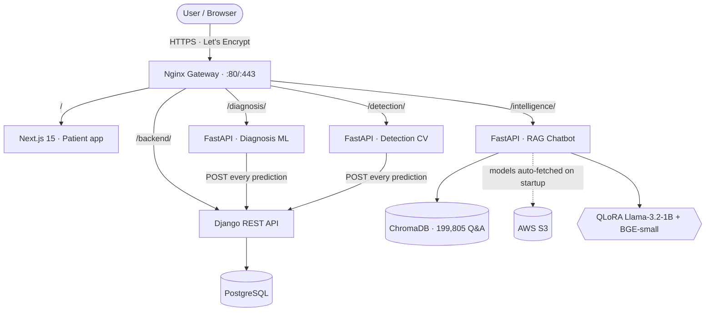

<div align="center">

# 🧬 Biolabs

### An integrated, AI-native digital health platform — biochemical monitoring, ML diagnostics, personalized nutrition, and a personal health assistant, connecting people with labs and hospitals.

[](https://www.biolabsltd.com)
[](https://biofold.biolabsltd.com)


</div>

---

Biolabs turns a person's biochemistry into **action**. Submit a blood/biomarker panel and it scores every marker against healthy male/female ranges, flags what's high or low, computes an overall **health score**, links abnormalities to possible conditions, **ranks the foods that pull your worst markers back to normal**, screens symptoms for disease, predicts specific conditions from biochemistry, and answers your questions through a **self-hosted, personalized RAG health assistant** — grounded in 199,805 curated Q&A *and* your own records.

It's a **production-deployed microservices system**: a Next.js frontend, a Django REST core, and three independent FastAPI ML services behind an Nginx TLS gateway on AWS — every piece Dockerized, with models tracked in MLflow and served from S3.

## 🔗 Live

| Product | URL | What it is |
|---|---|---|
| **Biolabs** | https://www.biolabsltd.com | Patient app — biometrics, food scoring, diagnostics, AI chat |
| **Biofold** | https://biofold.biolabsltd.com | Biomedicine research surface — knowledge graph + structure/binding |

## 🏗️ Architecture



Microservices behind one Nginx gateway; only `80/443` are public. The **diagnosis** and **detection** services POST every prediction back to Django, so all results are stored centrally in PostgreSQL. The **intelligence** service auto-fetches its fine-tuned model + embeddings from S3 on startup.

## ✨ What it does

1. **Chat** about health questions, personal medical reports, and biochemical analysis.
2. **Recommend food** from biochemistry via a custom matrix algorithm.
3. **Show each biochemical** (high/low vs threshold), a **health score**, and possible diseases.
4. **Detect disease from symptoms** and return medicine, diet, and precautions.
5. **Predict specific diseases** (diabetes, liver condition) from biochemistry.
6. **Store & extract medical reports** and surface insights.
7. **Detect food from a photo** and match it to recommendations.

## 🧪 Machine learning — models & results

| Task | Approach | Data | Result |
|---|---|---|---|
| **Symptom → disease** | SVM | 4,920 records · 131 symptoms + gender → 41 diseases | **100%** precision / recall / F1 (held-out) |
| **Diabetes risk** | 5-algorithm **soft-voting ensemble** · Optuna-tuned · SMOTE-balanced · SHAP-explained | 1,000 records | **97.99%** test accuracy |
| **Liver condition** | 5-algorithm **soft-voting ensemble** · Optuna · SMOTE · SHAP | UCI Hepatitis-C → 4 classes (Healthy / Hepatitis / Fibrosis / Cirrhosis) | **98.31%** test accuracy |
| **Food detection** | TensorFlow **SSD-MobileNet V2 (COCO)** | user image → labels | matched to recommendations |
| **Health assistant** | **QLoRA fine-tuned Llama-3.2-1B** + fine-tuned **BGE-small** RAG over ChromaDB | 199,805 Q&A | personalized with user biometrics/records |

All classical models are **tracked and versioned in MLflow** and packaged into their service images.

## 🔬 How the core algorithms work

**Biochemical scoring** — a reference DB of **58 biochemicals across 9 categories**, each with male/female thresholds. Every reading maps onto a scale from negative to positive infinity (healthy limits at **−1 / +1**, optimum at **0**); a **health weight** converts it (1 = optimum, 0 = limit, negative = out of range), and the **health score** is their sum. Readings expire on a validity period. **233 conditions** are linked across the 58 biochemicals.

**Food recommendation** (custom matrix math over **150 foods × 75 nutrients** + nutriscore):
1. Map each biochemical onto the −∞…+∞ scale (limits at −1/+1).
2. Multiply by the nutrient·biochemical and food·biochemical contribution matrices, then by **−1** — so foods that **counteract** an out-of-range biochemical score higher.
3. Sum across all biochemicals.
4. Weight each food's nutrient content by those nutrient scores.
5. **Final score = normalized nutrient + food + nutriscore.**

## 🧰 Tech stack

| Layer | Technology |
|---|---|
| **Frontend** | Next.js 15 (App Router, React) · Tailwind CSS · client-side Web Workers (OCR / biometrics / food) |
| **Core API** | Django + Django REST Framework · token auth · PostgreSQL |
| **ML services** | FastAPI · scikit-learn · TensorFlow · PyTorch + HuggingFace Transformers · ChromaDB · **SMOTE · SHAP · Optuna · MLflow** |
| **AI / LLM** | **QLoRA fine-tuned Llama-3.2-1B** · fine-tuned **BGE-small** embeddings · RAG |
| **Infra** | Docker + Docker Compose · Nginx reverse proxy · Let's Encrypt TLS · **Jenkins** CI/CD · **AWS** EC2 + S3 + Route 53 |

## 📁 Repository

```
Biolabs/
├── frontend/       Next.js 15 patient app
├── backend/        Django REST core — apps: webapp, adminpanel, diagnosis, mlmodel
├── diagnosis/      FastAPI — symptom SVM + diabetes & liver ensembles
├── detection/      FastAPI — TensorFlow SSD-MobileNet V2
├── intelligence/   FastAPI — RAG chatbot (Llama-3.2-1B + BGE + ChromaDB)
├── nginx/          TLS gateway + reverse-proxy configs
├── docker-compose.prod.yml
└── Jenkinsfile     CI pipeline
```

## 🔌 API at a glance

All services sit behind the gateway and share a `{ "data": { ... } }` request envelope.

| Route | Service | Purpose |
|---|---|---|
| `/backend/…` | Django | auth, users, biometrics, food scores, records |
| `/diagnosis/…` | FastAPI | symptom / diabetes / liver inference |
| `/detection/…` | FastAPI | image food detection |
| `/intelligence/inference` | FastAPI | personalized RAG chat |

## 🚀 Run it locally

```bash
git clone https://github.com/shiyasali23/Biolabs.git && cd Biolabs
cp backend/.env.example backend/.env            # set SECRET_KEY + DB_*
docker compose -f docker-compose.dev.yml up -d --build
docker compose -f docker-compose.dev.yml exec backend python manage.py create_admin  # migrate + seed
# app → http://localhost
```
> The fine-tuned LLM weights, embeddings and vector store for the `intelligence` service are large and **not** committed — they're auto-fetched from S3 (see `intelligence/.env.example`).

## 🌐 Deployment

Dockerized (each service has its own Dockerfile), orchestrated with Docker Compose, CI/CD via **Jenkins**, hosted on **AWS EC2** with an **Nginx** reverse proxy and **Let's Encrypt** SSL. Predictions from the diagnosis/detection services are POSTed back to the backend for central storage in PostgreSQL.

## 📈 Roadmap

- [ ] Managed PostgreSQL (RDS) + automated backups
- [ ] GPU autoscaling for the intelligence LLM service
- [ ] Full test coverage + GitHub Actions CI
- [ ] OpenAPI docs for every service

## 👤 Author

**Shiyas Ali** — [@shiyasali23](https://github.com/shiyasali23)

## 📄 License

Released under the [MIT License](LICENSE).
